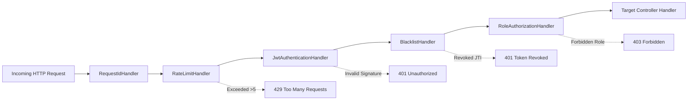

# SaveBite: Surplus Food Marketplace

[](https://www.oracle.com/java/)
[](https://javalin.io)
[](docs/PATTERNS.md)
[](src/test/java)
[](LICENSE)

> A production-style surplus-food marketplace that rescues near-expiry food at closing time, cuts carbon emissions, and **teaches all 23 Gang of Four (GoF) design patterns** live inside the running application.

---

## 1. Problem & Solution

### The Problem
Bakeries, cafes, and supermarkets throw away edible, high-quality food every evening simply because it has reached the end of the business day. Simultaneously, budget-conscious consumers and students pay full retail prices elsewhere. This mismatch results in:
1. **Massive food waste** (over 40% of surplus food ends in landfills).
2. **Economic loss** for local culinary businesses.
3. **Avoidable carbon footprint** ($2.5\text{ kg CO}_2\text{e}$ generated per kg of organic landfill waste).

### The SaveBite Solution
SaveBite creates a hyper-local marketplace connecting food sellers and conscious consumers:
- **Dynamic Near-Expiry Discounts:** Surplus food prices automatically scale down as closing hours approach.
- **Rescue Boxes & Bundles:** Composite food assortments sold at up to 70% off retail.
- **Zero Waste Pickup Slots:** Customers reserve surplus lots and collect them in designated evening windows.
- **Impact Telemetry:** Real-time metrics track cumulative food rescued in kilograms, money saved in rupees, and CO2 emissions prevented.

---

## 2. Tech Stack

- **Backend:** Java 17+, Javalin 6.3.0 (lightweight, unopinionated, embedded Jetty).
- **Database:** Embedded H2 2.3.x in file mode (`./data/savebite`) via plain JDBC repositories.
- **Security:** JJWT 0.12.6 (HMAC-SHA256, in-memory access token, `HttpOnly` refresh cookie, BCrypt password hashing).
- **Real-Time Streaming:** Server-Sent Events (SSE) for live pattern traces and price alerts.
- **Frontend:** Vanilla HTML5, modern CSS3 variables (Light/Dark themes), vanilla ES modules (zero npm build step).
- **Testing:** JUnit 5, AssertJ, Mockito (31 comprehensive unit, security, consistency, and integration tests).

---

## 3. Quickstart & Run Commands

### Prerequisites
- **JDK 17 or higher** installed (`java -version`).
- **Maven 3.6+** (or use included `mvnw` wrapper).

### Option A: One-Command Maven Build & Run
```bash
# Clean, package fat uber-jar, and start server
mvn clean package && java -jar target/savebite.jar
```
The server will start on port `7070`:
👉 **Open your browser at:** [http://localhost:7070](http://localhost:7070)

### Option B: Windows Helper Scripts
```cmd
# Double-click or run from cmd
.\run.bat
```
Or with PowerShell:
```powershell
.\run.ps1
```

### Option C: Linux / macOS / WSL
```bash
chmod +x run.sh
./run.sh
```

---

## 4. Default Demo Accounts

The application automatically seeds realistic demo data on first boot:

| Role | Email | Password | Preloaded Permissions |
|---|---|---|---|
| **Admin** | `admin@savebite.org` | `admin123` | System audit logs, platform impact totals, user management |
| **Seller** | `baker@savebite.org` | `baker123` | Create/edit listings, manage orders, export sales/impact reports |
| **Customer** | `customer@savebite.org` | `customer123` | Browse, dynamic search, cart with undo/redo, checkout, profile |

---

## 5. All 23 GoF Design Patterns Implementation Map

SaveBite implements **all 23 GoF Design Patterns** in realistic marketplace features. Each class is annotated with `@DesignPattern(name, role, description)` and verified by automated consistency tests:

| Pattern | Category | Feature Area | Screen / Component | Key Java Classes | Source Path | ADR Link |
|---|---|---|---|---|---|---|
| **Singleton** | Creational | System Config & Key Storage | App-wide | `ConfigManager`, `JwtKeyHolder`, `AppLogger` | [`singleton`](src/main/java/com/savebite/patterns/creational/singleton) | [ADR 0010](docs/adr/0010-singleton.md) |
| **Factory Method** | Creational | Multi-Channel Alerts | Toast / SMS / Email | `NotificationFactory`, `ToastNotification` | [`factorymethod`](src/main/java/com/savebite/patterns/creational/factorymethod) | [ADR 0011](docs/adr/0011-factory-method.md) |
| **Abstract Factory** | Creational | Light/Dark Theme Families | UI Theme Switcher | `ThemeFactory`, `LightThemeFactory`, `DarkThemeFactory` | [`abstractfactory`](src/main/java/com/savebite/patterns/creational/abstractfactory) | [ADR 0012](docs/adr/0012-abstract-factory.md) |
| **Builder** | Creational | Multi-Step Entity Construction | Cart, Listing, Claims | `OrderBuilder`, `ListingBuilder`, `JwtClaimsBuilder` | [`builder`](src/main/java/com/savebite/patterns/creational/builder) | [ADR 0013](docs/adr/0013-builder.md) |
| **Prototype** | Creational | 1-Click Order Reordering | Order Confirmation | `OrderPrototype`, `ReorderService`, `Prototype` | [`prototype`](src/main/java/com/savebite/patterns/creational/prototype) | [ADR 0014](docs/adr/0014-prototype.md) |
| **Adapter** | Structural | Social SSO Authentication | Login Modal | `GoogleAuthAdapter`, `GithubAuthAdapter`, `AuthProvider` | [`adapter`](src/main/java/com/savebite/patterns/structural/adapter) | [ADR 0015](docs/adr/0015-adapter.md) |
| **Bridge** | Structural | Multi-Format Report Export | Seller Dashboard | `Report`, `SalesReport`, `Exporter`, `CsvExporter` | [`bridge`](src/main/java/com/savebite/patterns/structural/bridge) | [ADR 0016](docs/adr/0016-bridge.md) |
| **Composite** | Structural | Categories & Rescue Bundles | Marketplace Catalog | `CatalogNode`, `Bundle`, `Category`, `ProductLeaf` | [`composite`](src/main/java/com/savebite/patterns/structural/composite) | [ADR 0017](docs/adr/0017-composite.md) |
| **Decorator** | Structural | Dynamic Surcharges & Coupons | Checkout Review | `Price`, `BasePrice`, `CouponDecorator`, `GiftWrapDecorator` | [`decorator`](src/main/java/com/savebite/patterns/structural/decorator) | [ADR 0018](docs/adr/0018-decorator.md) |
| **Facade** | Structural | Multi-Subsystem Orchestration | Login & Checkout | `CheckoutFacade`, `LoginFacade` | [`facade`](src/main/java/com/savebite/patterns/structural/facade) | [ADR 0019](docs/adr/0019-facade.md) |
| **Flyweight** | Structural | Allergen & Dietary Badges | Catalog Cards | `BadgeFlyweight`, `BadgeFactory` | [`flyweight`](src/main/java/com/savebite/patterns/structural/flyweight) | [ADR 0020](docs/adr/0020-flyweight.md) |
| **Proxy** | Structural | Caching, RBAC & Lazy Images | Admin & Marketplace | `CachingListingRepositoryProxy`, `AdminServiceProxy` | [`proxy`](src/main/java/com/savebite/patterns/structural/proxy) | [ADR 0021](docs/adr/0021-proxy.md) |
| **Chain of Resp.** | Behavioral | Inbound Security Pipeline | Inbound HTTP Filter | `SecurityPipeline`, `RequestIdHandler`, `JwtAuthHandler` | [`chainofresp.`](src/main/java/com/savebite/patterns/behavioral/chainofresponsibility) | [ADR 0022](docs/adr/0022-chain-of-responsibility.md) |
| **Command** | Behavioral | Undo/Redo Cart Operations | Slide-Over Cart Drawer | `Command`, `CommandHistory`, `AddToCartCommand`, `Cart` | [`command`](src/main/java/com/savebite/patterns/behavioral/command) | [ADR 0023](docs/adr/0023-command.md) |
| **Interpreter** | Behavioral | Food Query Mini-Language | Marketplace Search Bar | `Parser`, `Tokenizer`, `ComparisonExpression` | [`interpreter`](src/main/java/com/savebite/patterns/behavioral/interpreter) | [ADR 0024](docs/adr/0024-interpreter.md) |
| **Iterator** | Behavioral | Pagination & Circular Carousel | Listings & Deals Carousel| `CustomIterator`, `ListingAggregate`, `CarouselIterator` | [`iterator`](src/main/java/com/savebite/patterns/behavioral/iterator) | [ADR 0025](docs/adr/0025-iterator.md) |
| **Mediator** | Behavioral | Cascading Geographic Form | Checkout Address Modal | `CheckoutMediator`, `FormField`, `CountryField` | [`mediator`](src/main/java/com/savebite/patterns/behavioral/mediator) | [ADR 0026](docs/adr/0026-mediator.md) |
| **Memento** | Behavioral | Listing Draft Autosave & Undo | Profile & Listing Form | `ProfileEditor`, `ProfileSnapshot`, `SnapshotHistory` | [`memento`](src/main/java/com/savebite/patterns/behavioral/memento) | [ADR 0027](docs/adr/0027-memento.md) |
| **Observer** | Behavioral | Real-Time Events & SSE | Cart Badge, Alerts, SSE | `Subject`, `Observer`, `PriceDropSubject`, `CartBadge` | [`observer`](src/main/java/com/savebite/patterns/behavioral/observer) | [ADR 0028](docs/adr/0028-observer.md) |
| **State** | Behavioral | Listing Lifecycle Transitions | Listing Manager | `ListingContext`, `ListingState`, `FreshState`, `SoldState`| [`state`](src/main/java/com/savebite/patterns/behavioral/state) | [ADR 0029](docs/adr/0029-state.md) |
| **Strategy** | Behavioral | Near-Expiry Pricing Algorithms | Product Pricing Tag | `DiscountStrategy`, `ExpiryBasedDiscountStrategy` | [`strategy`](src/main/java/com/savebite/patterns/behavioral/strategy) | [ADR 0030](docs/adr/0030-strategy.md) |
| **Template Method**| Behavioral | Multi-Gateway Payment Flow | Checkout Payment Form | `PaymentProcessor`, `CardPayment`, `UpiPayment` | [`templatemethod`](src/main/java/com/savebite/patterns/behavioral/templatemethod) | [ADR 0031](docs/adr/0031-template-method.md) |
| **Visitor** | Behavioral | Environmental CO2/Tax Reports | Impact Dashboard | `CatalogVisitor`, `ImpactVisitor`, `WeightVisitor` | [`visitor`](src/main/java/com/savebite/patterns/behavioral/visitor) | [ADR 0032](docs/adr/0032-visitor.md) |

---

## 6. Architecture & Security Flow

### 6.1 Chain of Responsibility Security Pipeline
Every incoming HTTP request passes through `SecurityPipeline` before reaching any controller:



### 6.2 Token Security
- **Access Token:** Short-lived (15 minutes), kept **only in JavaScript memory**. Sent via `Authorization: Bearer <token>`. Never written to `localStorage`.
- **Refresh Token:** Long-lived (7 days), stored in an `HttpOnly`, `SameSite=Strict`, `Secure` cookie. Rotated on each refresh.
- **Logout:** Upon logout, the token's unique ID (`jti`) is added to the in-memory `BlacklistHandler` until expiry.

---

## 7. Interactive Teaching Features

### 💡 Contextual Pattern Button
Every feature area displays a **"💡 How does a design pattern solve this?"** button. Clicking it opens an accessible modal with:
1. **The Problem Here:** Exact engineering challenge in this feature.
2. **Pattern Used:** GoF name, category, and intent.
3. **Without vs With Pattern:** Before/after comparison showing why naive code fails.
4. **Real Code Live from Disk:** Reads and displays the actual Java source file with syntax highlighting.
5. **Live Server Proof:** Real-time data fetched from the backend (e.g., Singleton instance IDs, Chain handler trace, Flyweight memory counter, Memento snapshots).
6. **Viva Question & Model Answer:** Oral exam question with a crisp answer.
7. **Engineering Trade-off:** When not to use this pattern and its added cost.

### 📡 Live Pattern Trace Console
Click the terminal button in the bottom right corner to view real-time Server-Sent Events (SSE) streaming every pattern event in the system (`time`, `pattern`, `class`, `method`, `message`). Filter by pattern name and export traces to `.txt`.

---

## 8. Automated Test Suite

Run the full automated test suite verifying all 23 patterns, JWT security, and integration flows:
```bash
mvn test
```
**Test Results (31 Tests, 0 Failures):**
- `CreationalPatternsTest`: Singleton, Factory Method, Abstract Factory, Builder, Prototype.
- `StructuralPatternsTest`: Adapter, Bridge, Composite, Decorator, Facade, Flyweight, Proxy.
- `BehavioralPatternsTest`: Chain, Command, Interpreter, Iterator, Mediator, Memento, Observer, State, Strategy, Template Method, Visitor.
- `JwtSecurityTest`: Signature verification, tamper detection, rate-limiting lockout, blacklist revocation.
- `PatternConsistencyTest`: Validates `@DesignPattern` annotations against `patterns.json`.
- `IntegrationFlowTest`: Complete end-to-end user journey (register, login, search, cart, checkout, logout).

---

## 9. Documentation References
- [Architecture Decision Records (ADR Index)](docs/adr/0000-index.md)
- [Complete 23 Patterns Catalog & UML](docs/PATTERNS.md)
- [Live Presentation Script & Top 30 Viva Voce Questions](docs/DEMO_GUIDE.md)
